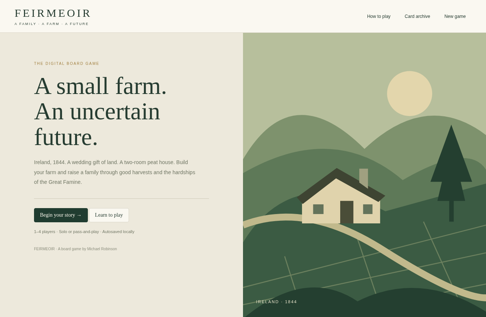
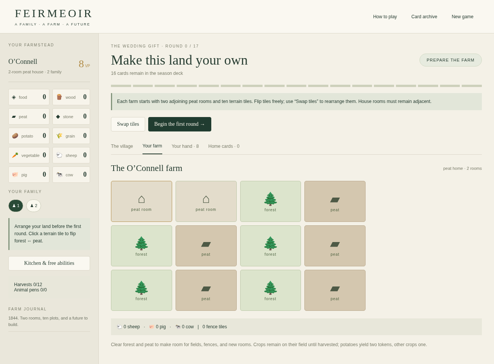

# FEIRMEOIR
### A family · A farm · A future

**A browser-based adaptation of the original Feirmeoir board game by Michael Robinson.**

Ireland, 1844. Start with a modest peat home and a few plots of land. Grow crops, keep livestock, build a household, and make difficult choices as famine-era harvests approach. At the end of twelve harvests, the family with the strongest farmstead wins.



## Play the game

**No installation or account is required.** There are two supported ways to play:

- **Offline:** Download the `Feirmeoir-v0.1.0-Offline.zip` asset from the [Releases](../../releases) page. Extract it, then double-click **`Feirmeoir.html`** in a modern desktop browser. It contains the artwork and rules, so it does not need the internet.
- **Online:** Enable GitHub Pages for this repository (instructions below) to play the browser version. The `docs/` directory contains the complete site. You can also host it on any static web host.

> The multi-file `docs/index.html` edition must be served over HTTP(S), not opened directly with `file://`, because it loads `cards.json`. For double-click offline use, choose the self-contained HTML release.

## Game features

- **1–4 players:** solo high-score play or local pass-and-play multiplayer on the same screen.
- **Farm management:** clear land, sow crops, raise animals, build fences and homes, and renovate from peat to wood or stone.
- **Worker placement:** put family members to work at shared village action spaces while managing scarce supplies.
- **Card play:** home improvements, new village actions, and seasonal harvests based on the supplied board-game cards.
- **Difficult winters:** feed your family, heat your rooms, handle taxes and blight, recover from sickness, or emigrate.
- **Local saving:** the game automatically saves progress to your browser's local storage, when storage is available.
- **Original materials:** original card artwork and an in-game link to the board-game rules PDF.



## How a game works

1. Choose one to four families and arrange each starting farmstead.
2. Reveal season cards, play cards from your hand, and visit village action spaces with family members.
3. Clear land, sow crops, raise livestock, and improve your home while building enough food and fuel reserves.
4. Resolve harvests, including blight, taxes, feeding, and heating.
5. After the final good harvest, compare the farmstead victory-point totals.

The optional **preparation round** is enabled by default to give families a chance to act before a potentially harsh first draw. You can turn it off to use the original immediate-draw sequence. The game's **How to play** window documents the adaptation's explicit rules interpretations.

## Browser and save notes

Works in current desktop browsers with JavaScript enabled. The interface is intended primarily for desktop screens; browser compatibility across all devices has not been formally certified. Saves are stored **locally in the browser**, not synced to an account. Clearing site data can erase them. File-based offline browser storage can vary by browser; the hosted edition generally offers more reliable storage. No network multiplayer or computer-controlled opponents are included.

## Develop locally

There is **no package manager or dependency installation step**. You will need Python 3 to serve and package the site, and Node.js to run the automated rules suite.

```bash
# From the repository root, serve the website
python -m http.server 8000 --directory docs
# Open http://localhost:8000
```

```bash
# Run the rules test suite (Node.js)
node tests/rules.test.cjs

# Verify artwork and file references (Python 3)
python tools/verify_assets.py

# Rebuild the standalone HTML and offline ZIP in build/
python tools/build_offline.py --zip
```

These commands work on Windows, macOS, and Linux with the listed runtimes. If your system uses `py` rather than `python`, substitute that command.

## Publish with GitHub Pages

The repository includes a ready-to-use Pages workflow in `.github/workflows/pages.yml`.

1. Create a GitHub repository and upload the **contents** of the GitHub source ZIP to its default branch (`main` is assumed).
2. In **Settings → Pages → Build and deployment → Source**, choose **GitHub Actions**.
3. Push to `main`, or start the **Deploy Feirmeoir to GitHub Pages** workflow from the **Actions** tab.
4. Once deployment succeeds, the resulting Pages link appears in the deployment details. Add that link to your repository's **About → Website** field.

GitHub Pages may need to be enabled by a repository administrator. The workflow cannot turn it on automatically.

## Repository structure

```text
.github/workflows/   CI checks and GitHub Pages publishing
.github/ISSUE_TEMPLATE/  Bug reports and feature requests
docs/                Complete static website and original game assets
media/               Screenshots for this README
tests/               Dependency-free Node.js game-rules tests
tools/               Offline HTML builder and asset verifier
CHANGELOG.md         Release history
CONTRIBUTING.md      Contribution and testing guide
LICENSE.md           Copyright and reuse terms
RELEASE.md           Maintainer checklist and release description
```

## Status and known limitations

**v0.1.0 — initial playable digital adaptation.** The rules engine and main browser flows have been tested; final editorial review of rules interpretations against the physical game is still welcome. This is not an official multiplayer server, and it has no AI opponent. See [CHANGELOG.md](CHANGELOG.md) for details.

For bug reports, please include the browser, whether the online or offline edition was used, the number of families, the last action, and steps to reproduce the issue. Do not publicly share save files containing personal information.

## Credits and rights

**Feirmeoir**, its board-game design, rules, and supplied original artwork: **Michael Robinson**.

All rights reserved unless permission is explicitly granted. A public GitHub repository does **not** automatically grant an open-source license. Please read [LICENSE.md](LICENSE.md) before copying or redistributing any code or assets.
